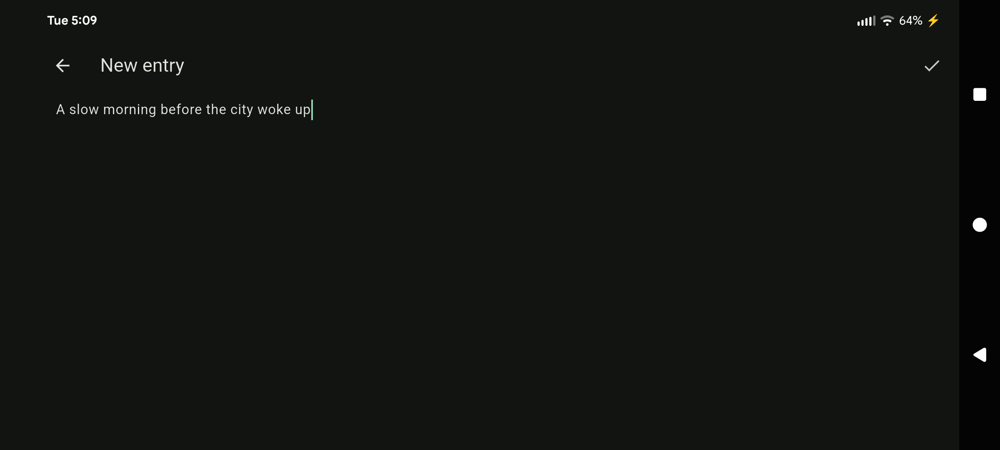
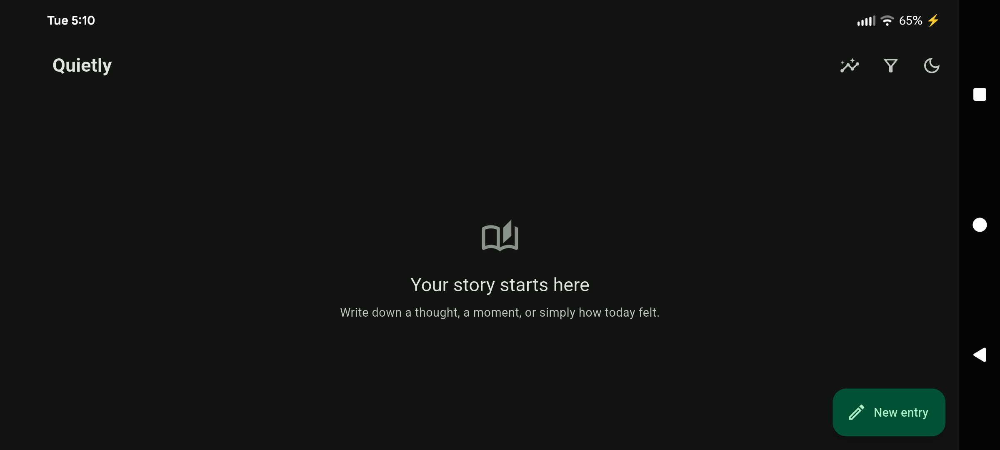

<div align="center">
  

# Video Diary

**A little space to hear your own thoughts.**

A private, offline journal for daily moments, moods, and reflections.

[](https://github.com/kargalar/video-diary/releases/latest) [](https://github.com/kargalar/video-diary/releases/latest) [](LICENSE)

[Download for Android ↓](https://github.com/kargalar/video-diary/releases/latest) · [Build from source](#build-from-source) · [Report an issue](https://github.com/kargalar/video-diary/issues)

</div>



## A journal that stays yours

Open a fresh entry, write what is on your mind, and add a mood or rating when you want. Video Diary keeps your journal on your device and works without an account.



## Features

- Write and edit entries with a title and free-form text.
- Add a mood, a 1–5 rating, and people tags.
- Filter entries by date, rating, mood, and person.
- Review writing statistics and recurring words in the Analysis view.
- Choose a light or dark theme.
- Keep journal data locally on your device.

## Build from source

Install [Flutter](https://docs.flutter.dev/get-started/install), then run:

```sh
flutter pub get
flutter analyze
flutter test
flutter run
```

## License

Video Diary is licensed under the GNU General Public License v3.0. See [LICENSE](LICENSE).
