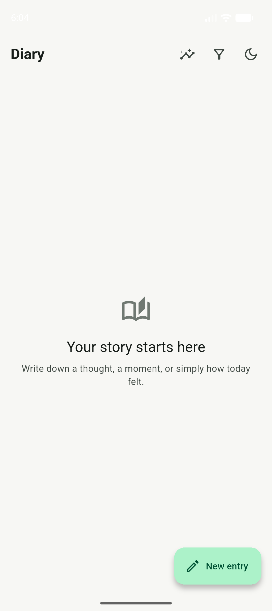
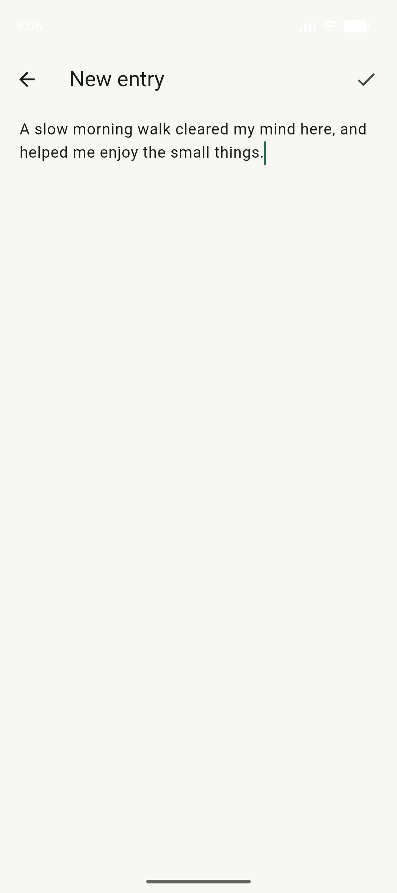

<div align="center">
  

# Diary

**A private space to make sense of everyday moments.**

An offline journal for writing, reflecting, and noticing the patterns in your days.

[](https://github.com/kargalar/diary/releases/latest) [](https://github.com/kargalar/diary/releases/latest) [](LICENSE)

[Download for Android ↓](https://github.com/kargalar/diary/releases/latest) · [Build from source](#build-from-source) · [Report an issue](https://github.com/kargalar/diary/issues)

</div>



## Make room for reflection

Capture a thought while it is still fresh, add context when it helps, and return to your entries whenever you need a clearer view of your days. Diary keeps entries on your device and works without an account.



## Features

- Write, edit, and remove journal entries.
- Add a mood, a 1–5 rating, and people tags.
- Filter entries by date, mood, rating, or person.
- Review writing patterns and personal statistics in the Analysis view.
- Switch between light and dark themes.
- Keep journal data locally on your device.

## Build from source

Install [Flutter](https://docs.flutter.dev/get-started/install), then run:

```sh
flutter pub get
flutter analyze
flutter test
flutter run
```

## License

Diary is licensed under the GNU General Public License v3.0. See [LICENSE](LICENSE).